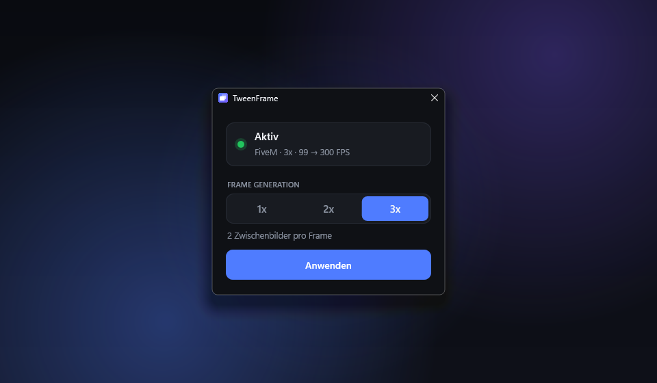

# 🎞️ TweenFrame

**Frame Generation für FiveM – geschrieben in Rust.**
Aus 100 FPS werden 300. Keine Injection, kein Konto, kein Schnickschnack.



## Warum TweenFrame?

Monitore schaffen heute 240 oder 300 Hz, FiveM schafft das selten. TweenFrame berechnet zwischen zwei echten Bildern ein oder zwei Zwischenbilder, und das Spiel wirkt so flüssig wie mit doppelter oder dreifacher Bildrate.

- **100 → 300 FPS** auf einem 300-Hz-Monitor
- **~10 ms** zusätzliche Verzögerung (ein Spiel-Frame bei 100 FPS)
- **~8 % GPU-Last** bei 1440p (RX 9060 XT)
- **~450 KB** große `.exe`, keine Installation

## Funktionen

- **2x und 3x** Frame Generation, umschaltbar ohne Neustart
- **Sauberes Bild** – die Bewegung wird in beide Richtungen geschätzt, Verdeckungen ohne Geisterbilder
- **Scharfes HUD** – Minimap, Chat und Fadenkreuz werden nicht verzerrt
- **Keine Injection** – das Bild wird über *Windows.Graphics.Capture* abgegriffen, wie bei OBS
- **Automatisch** – erkennt FiveM, startet und pausiert von selbst (z. B. bei Alt-Tab)
- **Schaltet sich ab, wenn es nichts bringt** – läuft das Spiel schon fast mit Monitor-Hz, gibt es keinen Lag und keine GPU-Last
- **Minimalistisch** – kleines Fenster mit Status, 1x/2x/3x und Anwenden, danach läuft TweenFrame im Tray

## Benutzung

1. `TweenFrame.exe` aus den [Releases](https://github.com/hanitazu/TweenFrame/releases) laden und starten
2. In FiveM unter **Einstellungen → Grafik → Bildschirmtyp** auf **Randloses Fenster** stellen
3. **2x** oder **3x** wählen und auf **Anwenden** klicken – das Fenster geht ins Tray
4. Spielen. Ist FiveM im Vordergrund, bekommt das Tray-Icon einen grünen Punkt

Klick aufs Tray-Icon öffnet das Fenster wieder, Rechtsklick → **Beenden** schließt TweenFrame.

### Bestes Ergebnis

| Monitor | FiveM begrenzen auf | Modus |
|---|---|---|
| 300 Hz | 100 FPS | 3x |
| 240 Hz | 80 FPS / 120 FPS | 3x / 2x |
| 144 Hz | 72 FPS | 2x |

FPS begrenzen geht z. B. mit **Radeon Chill** (AMD), **Max. Bildrate** in der NVIDIA-Systemsteuerung oder RTSS. Stabile FPS sind wichtiger als hohe.

## Installieren

Voraussetzungen: Windows 10/11, [Rust](https://rustup.rs) und die Visual Studio Build Tools (C++).

```powershell
git clone https://github.com/hanitazu/TweenFrame.git
cd TweenFrame
cargo build --release
copy target\release\tweenframe.exe TweenFrame.exe
```

## Technik

- **Rust** mit [`windows-rs`](https://github.com/microsoft/windows-rs), Rechenarbeit in **Direct3D 11 Compute Shadern** (HLSL)
- **Erfassung** über *Windows.Graphics.Capture* – das Bild bleibt komplett auf der Grafikkarte
- **Optischer Fluss**: Block-Matching über 5 Pyramidenstufen, vorwärts und rückwärts, mit zeitlicher Vorhersage und Sub-Pixel-Genauigkeit
- **Zwischenbild**: pro Pixel 3 Kandidaten (statisch / vorwärts / rückwärts), gewichtet nach Übereinstimmung; bei Verdeckungen wird das zeitlich nähere echte Bild genommen
- **Ausgabe**: durchklickbares Overlay mit Flip-Model-Swapchain, synchron zum Monitor
- **Oberfläche**: Win32 + Direct2D, ohne Framework

Einstellungen und Log liegen unter `%APPDATA%\TweenFrame`.

## FAQ

**Kann ich dafür gebannt werden?**
TweenFrame verändert weder das Spiel noch dessen Speicher, es liest nur das Bild wie OBS oder Discord. Eine Garantie gibt es trotzdem nicht – manche Server verbieten jegliche Zusatz-Tools. Nutzung auf eigene Verantwortung.

**Der FPS-Zähler im Spiel zeigt nur 100?**
Richtig, das Spiel rendert weiter 100 echte Bilder. Die Zwischenbilder sieht nur dein Monitor.

**Der Status zeigt „Nicht nötig“?**
FiveM läuft schon mit fast so vielen FPS, wie dein Monitor Hz hat. Begrenze die FPS auf den angezeigten Wert, dann schaltet sich TweenFrame ein.

**Ich sehe das Tray-Icon nicht?**
Windows 11 legt neue Icons ins „^“-Menü. TweenFrame schaltet sein Icon auf „immer anzeigen“, das greift ab dem nächsten Anmelden – oder du ziehst es einmal aus dem „^“ auf die Taskleiste.

## Über das Projekt

TweenFrame ist mein eigenes Projekt – Idee, Design und Richtung kommen von mir.

Nicht verbunden mit Cfx.re, Rockstar Games oder Take-Two Interactive.

## Lizenz

[MIT](LICENSE)
